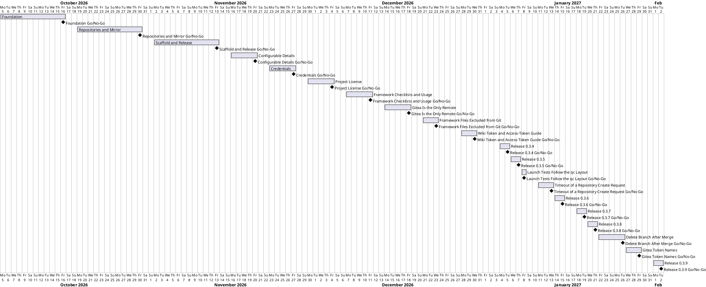

# Project Plan

## Metadata
| Key | Value |
| --- | --- |
| ID | PP-001 |
| CrossReference | [BC-001], [SA-001], [MIL-001], [MIL-002], [MIL-003], [MIL-004], [MIL-005], [MIL-006], [MIL-007], [MIL-008], [MIL-009], [MIL-010], [MIL-011], [MIL-012], [MIL-013], [MIL-014], [MIL-015], [MIL-016], [MIL-017], [MIL-018], [MIL-019], [MIL-020], [US-001] |

## Version History
| Date | Status | Author | Reviewer | Change | Commit |
| --- | --- | --- | --- | --- | --- |
| 2026-10-29 | Deprecated | Jens Tirsvad Nielsen | S02 | Added phases MIL-018 (2027-01-22 to 2027-01-26, delete branch after merge) and MIL-019 (2027-01-27 to 2027-01-29, Gitea token names), proposed dates | [4ecfb14] |
| 2026-10-29 | Accepted | Jens Tirsvad Nielsen | S02 | Added phase MIL-020 (proposed dates 2027-02-01 to 2027-02-02): release 0.3.9 | pending |

---

## Purpose

Schedule the fifteen phases that deliver RepoFoundry (`create-project.sh` and its documentation) in dependency order. The Business Case sets no deadline, so the dates below are proposals for S01 to confirm.

## Planning Assumptions

- Week 1 starts 2026-10-05; the plan ends by 2027-01-15 (the last ten phases are proposed).
- Phase length: two weeks.
- S01 and S02 review each phase through a pull request, as described in [SA-001]. For now one person holds both roles.
- The PO language is English, so no translated copies are kept.

## Gateway Schedule

| Gateway | Document | Window | Decision date | Owner | Stories | Main deliverable | Milestone |
| --- | --- | --- | --- | --- | --- | --- | --- |
| Foundation | [MIL-001] | 2026-10-05 to 2026-10-16 | 2026-10-16 | S01 | US-001.01 | Safe skeleton, config parsing, prompts, tests | [Milestone 43] |
| Repositories and Mirror | [MIL-002] | 2026-10-19 to 2026-10-30 | 2026-10-30 | S02 | US-001.02 | GitHub and Gitea repositories and the push mirror | [Milestone 44] |
| Scaffold and Release | [MIL-003] | 2026-11-02 to 2026-11-13 | 2026-11-13 | S01 | US-001.03 | Local project, framework, README, final review | [Milestone 45] |
| Configurable Details | [MIL-004] | 2026-11-16 to 2026-11-20 | 2026-11-20 | S01 | US-001.04 | Project details preset in config.env | |
| Credentials | [MIL-005] | 2026-11-23 to 2026-11-27 | 2026-11-27 | S01 | US-001.05 | Missing credentials asked; project .env | |
| Project License | [MIL-006] | 2026-11-30 to 2026-12-04 | 2026-12-04 | S01 | US-001.06 | PROJECT_LICENSE in config.env; AGPL-3.0 default only for a public GitHub project | |
| Framework Checklists and Usage | [MIL-007] | 2026-12-07 to 2026-12-11 | 2026-12-11 | S01 | US-001.07 | qc fetched with the framework; global command; README usage | |
| Gitea Is the Only Remote | [MIL-008] | 2026-12-14 to 2026-12-18 | 2026-12-18 | S01 | US-001.03 | The local project has `origin` only; GitHub is reached through the mirror | |
| Framework Files Excluded from Git | [MIL-009] | 2026-12-21 to 2026-12-23 | 2026-12-23 | S01 | US-001.03 | `.claude`, `.agents` and `AGENTS.md` excluded from git in the new project | |
| Wiki Token and Access-Token Guide | [MIL-010] | 2026-12-28 to 2026-12-30 | 2026-12-30 | S01 | US-001.05 | `TOKEN_FOR_GITEA_WIKI` accepted in `.env`; access-token guide in the wiki | |
| Release 0.3.4 | [MIL-011] | 2027-01-04 to 2027-01-05 | 2027-01-05 | S01 | US-001 | Version 0.3.4 released on Gitea with its changelog entry | |
| Release 0.3.5 | [MIL-012] | 2027-01-06 to 2027-01-07 | 2027-01-07 | S01 | US-001 | Version 0.3.5 released on Gitea with its changelog entry | |
| Launch Tests Follow the qc Layout | [MIL-013] | 2027-01-08 to 2027-01-08 | 2027-01-08 | S01 | US-001 | The two launch tests pass against the checklists in `framework/qc/artifacts/` | |
| Timeout of a Repository Create Request | [MIL-014] | 2027-01-11 to 2027-01-13 | 2027-01-13 | S01 | US-001.02 | The cause of issue 107 is found and a timeout of a create request is handled | |
| Release 0.3.6 | [MIL-015] | 2027-01-14 to 2027-01-15 | 2027-01-15 | S01 | US-001 | Version 0.3.6 released on Gitea with its changelog entry | |
| Release 0.3.7 | [MIL-016] | 2027-01-18 to 2027-01-19 | 2027-01-19 | S01 | US-001 | Version 0.3.7 released on Gitea with its changelog entry | |
| Release 0.3.8 | [MIL-017] | 2027-01-20 to 2027-01-21 | 2027-01-21 | S01 | US-001 | Version 0.3.8 released on Gitea with its changelog entry | |
| Delete Branch After Merge | [MIL-018] | 2027-01-22 to 2027-01-26 | 2027-01-26 | S01 | US-001.02 | A new Gitea repository has "Delete pull request branch after merge by default" on | |
| Gitea Token Names | [MIL-019] | 2027-01-27 to 2027-01-29 | 2027-01-29 | S01 | US-001 | `create-project.sh` accepts the `TOKEN_FOR_GITEA_*` keys of the framework | |
| Release 0.3.9 | [MIL-020] | 2027-02-01 to 2027-02-02 | 2027-02-02 | S01 | US-001 | Version 0.3.9 released on Gitea with its changelog entry | |



## Scope Coverage

| Business Case scope item | Gateway |
| --- | --- |
| Safe parsing of `config.env` and `.env`, tool checks, prompts, `.gitignore` | [MIL-001] |
| Project name check on GitHub | [MIL-001] |
| Creation of both repositories and the push mirror | [MIL-002] |
| Partial-failure reporting | [MIL-002] |
| Local directory, remotes, framework submodule, skills, hooks, templates, plan gate | [MIL-003] |
| README and SSH prerequisite documentation | [MIL-003] |
| Project details set in `config.env` instead of asked | [MIL-004] |
| Missing credentials asked; the new project's `.env` | [MIL-005] |
| Project license set in `config.env` | [MIL-006] |
| Framework's own submodules fetched | [MIL-007] |
| README usage from the target folder and as a global command | [MIL-007] |
| The local project has `origin` as its only remote | [MIL-008] |
| `.claude`, `.agents` and `AGENTS.md` excluded from git in the new project | [MIL-009] |
| `TOKEN_FOR_GITEA_WIKI` accepted in `.env`; access-token guide in the wiki | [MIL-010] |
| Version 0.3.4 released | [MIL-011] |
| Version 0.3.5 released | [MIL-012] |
| The two launch tests pass against the checklists in `framework/qc/artifacts/` | [MIL-013] |
| The cause of issue 107 is found and a timeout of a create request is handled | [MIL-014] |
| Version 0.3.6 released | [MIL-015] |
| Version 0.3.7 released | [MIL-016] |
| Version 0.3.8 released | [MIL-017] |
| A new Gitea repository has the delete-branch-after-merge setting on | [MIL-018] |
| `create-project.sh` accepts the Gitea token names of the framework | [MIL-019] |
| Version 0.3.9 released | [MIL-020] |

## Dependencies

```
MIL-001 → MIL-002 → MIL-003 → MIL-004 → MIL-005 → MIL-006 → MIL-007 → MIL-008 → MIL-009 → MIL-010 → MIL-011 → MIL-012 → MIL-013 → MIL-014 → MIL-015 → MIL-016 → MIL-017 → MIL-018 → MIL-019 → MIL-020
```

A No-Go moves every later date by the time needed to rework the failed criteria.

## Plan Risks

| Risk | Impact | Mitigation |
| --- | --- | --- |
| No disposable GitHub organization for testing | Organization-owner path untested | Agree the test owners before [MIL-002] starts |
| Gitea API behaviour differs from the swagger on the live server | Mirror task takes longer | Test against `git.tirsystem.com` early in [MIL-002] |

## Open Issues

- Decided: the proposed dates are accepted with this plan (S01 asked for its acceptance on 2026-10-05); a change needs a new Version History row.
- Decided: `origin` uses HTTPS derived from `GITEA_URL`, unless the SSH test passed, in which case it uses SSH on port 10022.
- Decided: use case [UC-001] "Create a new project" is created, with [SSD-001]; tasks that implement its steps reference it.
- Decided: S01 and S02 are both held by one person for now.
- Open: this plan says the script does not make the first commit; confirm before MIL-003 starts.

---

[BC-001]: ./business-case.md
[SA-001]: ./stakeholder-analysis.md
[MIL-001]: ./milestones/mil-001-foundation.md
[MIL-002]: ./milestones/mil-002-repositories-and-mirror.md
[MIL-003]: ./milestones/mil-003-scaffold-and-release.md
[MIL-004]: ./milestones/mil-004-configurable-details.md
[MIL-005]: ./milestones/mil-005-credentials.md
[MIL-006]: ./milestones/mil-006-project-license.md
[MIL-007]: ./milestones/mil-007-framework-checklists.md
[MIL-008]: ./milestones/mil-008-gitea-only-remote.md
[MIL-009]: ./milestones/mil-009-exclude-framework-files.md
[MIL-010]: ./milestones/mil-010-wiki-token-and-access-token-guide.md
[MIL-011]: ./milestones/mil-011-release-0-3-4.md
[MIL-012]: ./milestones/mil-012-release-0-3-5.md
[MIL-013]: ./milestones/mil-013-launch-tests-qc-layout.md
[MIL-014]: ./milestones/mil-014-github-create-timeout.md
[MIL-015]: ./milestones/mil-015-release-0-3-6.md
[MIL-016]: ./milestones/mil-016-release-0-3-7.md
[MIL-017]: ./milestones/mil-017-release-0-3-8.md
[MIL-018]: ./milestones/mil-018-delete-branch-after-merge.md
[MIL-019]: ./milestones/mil-019-gitea-token-names.md
[MIL-020]: ./milestones/mil-020-release-0-3-9.md
[US-001]: ./user-stories.md
[UC-001]: ./use-cases/uc-001/uc.md
[SSD-001]: ./use-cases/uc-001/ssd.md
[Milestone 43]: https://git.tirsystem.com/TirSystem-BashScript/RepoFoundry/milestone/43
[Milestone 44]: https://git.tirsystem.com/TirSystem-BashScript/RepoFoundry/milestone/44
[Milestone 45]: https://git.tirsystem.com/TirSystem-BashScript/RepoFoundry/milestone/45
[d1120f7]: https://git.tirsystem.com/TirSystem-BashScript/repo-foundry/commit/d1120f7da03f41e6af8b5f35d860eee5bfd5f015
[7823687]: https://git.tirsystem.com/TirSystem-BashScript/repo-foundry/commit/7823687baf39c26161876c59382eaa3f8683940e
[6696dce]: https://git.tirsystem.com/TirSystem-BashScript/repo-foundry/commit/6696dcebb97825b66c385e1cd6a51e5ef16fd939
[2d3932f]: https://git.tirsystem.com/TirSystem-BashScript/repo-foundry/commit/2d3932f135d56411439477dead63a21f0bc35294
[4ecfb14]: https://git.tirsystem.com/TirSystem-BashScript/repo-foundry/commit/4ecfb143a9f06c007f61da7f8e98dc331b727442
